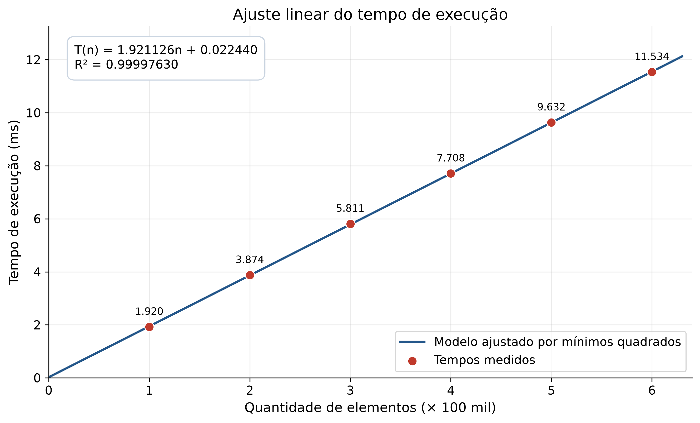
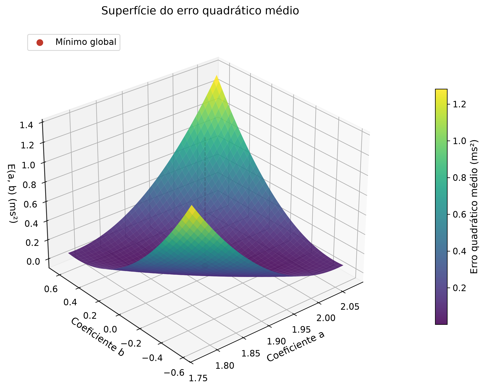
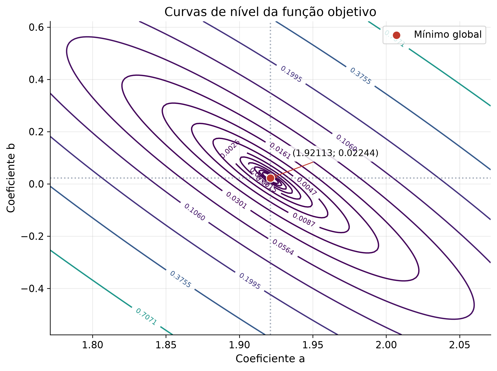
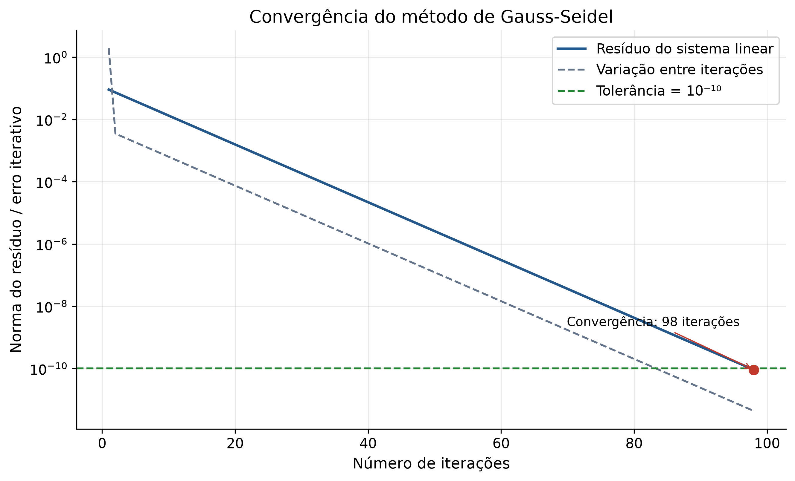

# Mínimos Quadrados: regressão linear e métodos numéricos

Implementação de um experimento de **Cálculo Numérico** para ajustar uma reta aos tempos de uma busca sequencial e resolver o sistema normal por dois métodos: **eliminação de Gauss** e **Gauss-Seidel**.

> Trabalho de Cálculo III — comparação entre modelagem matemática, métodos iterativos e visualização de resultados.

## Visão geral

O experimento mede o tempo de uma busca sequencial em vetores de 100 mil a 600 mil elementos. Os dados são normalizados como `n = tamanho / 100000` e ajustados pelo modelo linear:

```text
T(n) = a·n + b
```

Os coeficientes `a` e `b` são obtidos minimizando o erro quadrático médio. Para isso, o projeto:

1. executa o benchmark e salva os tempos em `dados.csv`;
2. monta o sistema normal dos mínimos quadrados;
3. resolve o sistema por Gauss ou Gauss-Seidel;
4. valida os resultados com `numpy.linalg.solve`;
5. gera gráficos da regressão, da função objetivo e da convergência.

## Resultados visuais

### Ajuste linear



### Superfície do erro



### Curvas de nível



### Convergência de Gauss-Seidel



Versões em PDF dos gráficos também estão disponíveis em `figuras/graficos/`, adequadas para impressão e relatório.

## Estrutura do repositório

```text
.
├── benchmark.py             # mede o custo da busca sequencial
├── otimizacao.py            # Gauss, Gauss-Seidel e análise do ajuste
├── comparacao.py            # compara os métodos com NumPy
├── graficos.py              # gera PNG e PDF dos gráficos
├── dados.csv                # tempos medidos do benchmark
├── convergencia.csv         # histórico das iterações de Gauss-Seidel
├── ambiente.txt             # registro do ambiente computacional
└── figuras/
    ├── graficos/            # resultados visuais reproduzíveis
    └── prints/              # evidências das execuções
```

## Como executar

Requer Python 3.10 ou superior, NumPy e Matplotlib.

```bash
python -m venv .venv
source .venv/bin/activate       # Linux/macOS
pip install -r requirements.txt
```

Na sequência, os comandos principais são:

```bash
# 1. (Opcional) gerar novamente o benchmark
python benchmark.py

# 2. Resolver por eliminação de Gauss
python otimizacao.py gauss

# 3. Resolver por Gauss-Seidel e atualizar convergencia.csv
python otimizacao.py seidel

# 4. Comparar Gauss, Gauss-Seidel e NumPy
python comparacao.py

# 5. Recriar todos os gráficos em PNG e PDF
python graficos.py
```

Os scripts devem ser executados a partir da raiz do repositório, pois os arquivos CSV são carregados por caminhos relativos.

## Dados e interpretação

O benchmark utiliza busca sequencial com o alvo ausente, portanto cada execução percorre todo o vetor. O crescimento aproximadamente linear observado nos dados é compatível com a complexidade `O(N)` da busca.

O sistema normal é construído a partir da matriz de projeto `[n, 1]`. A função objetivo é quadrática e estritamente convexa no domínio analisado; por isso, o ponto destacado nos gráficos corresponde ao mínimo global do ajuste.

## Organização dos arquivos

- `dados.csv` e `convergencia.csv` são resultados tabulares das execuções.
- `figuras/graficos/` reúne as visualizações finais, em formatos raster e vetorial.
- `figuras/prints/` preserva capturas das etapas e saídas de terminal.
- `ambiente.txt` documenta o ambiente utilizado para a coleta original.
- `requirements.txt` lista apenas as dependências necessárias para reproduzir os cálculos e gráficos.

## Autoria

Repositório acadêmico de **Garrard Fontanive** para a disciplina de Cálculo III.
